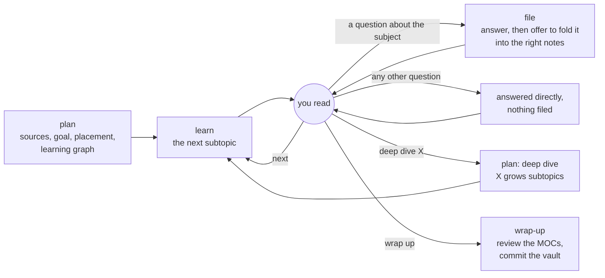

# appledore

**Build your Obsidian vault while you learn.** Plan a topic with an AI agent as a learning graph, read it one bite-sized subtopic at a time, and every question you ask about it is answered from sources you agreed on and filed into your vault as linked notes. Your mind palace grows during the session, not in a note-taking chore afterwards.

[](LICENSE)
[](#install)
[](AGENTS.md)
[](skills/study/scripts/appledore.py)
[](https://obsidian.md)

> In *Sherlock*'s "His Last Vow", everyone hunts for the vaults under Appledore, Charles Augustus Magnussen's house. There are no vaults: it was all in his mind palace. This project runs the other way. Your mind palace becomes a vault.

---

## Why

Learning a technical topic with an AI usually goes like this: ask for an explainer, read it, ask follow-ups, get good answers, and lose them in chat history. Notes, if they happen at all, come later, by hand, and the habit rarely survives a busy month.

appledore makes the learning session itself the note-taking:

- **Planned, not dumped.** Before anything is written, you and the agent agree on the sources, your goal (an exam, a project, an interview, not "everything about it"), where the topic sits in your vault, and a learning graph of subtopics, prerequisites first.
- **Taught in bites.** Each subtopic teaches at most three new concepts in 150–450 words, uses only what its prerequisites taught, and ends with what it **left out on purpose**, as questions you can pick next.
- **Every answer lands in the vault.** Ask anything about the topic while reading. The answer is folded into the notes it belongs in, or becomes a new subtopic, after your yes.
- **Grounded.** Every claim comes from the sources you agreed on. When they don't cover something, the agent says so and proposes a page, and it never fills a gap from memory.
- **A vault that stays navigable.** Every note sits in a MOC chain. A script checks the vault's invariants after every write, and a wrap-up reviews the structure and commits.

## A session



Start it with `/appledore:study <topic>`, then talk to it:

| You say | What happens |
|---|---|
| *(a new topic)* | **plan:** it looks through your vault for what you already know, asks for 2–5 sources, your goal and where the topic belongs, and proposes a learning graph for you to edit. Then it writes the topic note and one stub per planned subtopic. |
| `next` | **learn:** it writes the next subtopic whose prerequisites are done, opens it in Obsidian and gives you its `obsidian://` link. After the last one, it lists every stub the topic left out, for your next deep dive. |
| a question about the subject | **file:** it answers from the agreed sources, then offers in one line to file the answer: inside one or more existing notes, or as a new subtopic. When the vault already answers it, you get that note's link instead. `just answer` turns the offer off. |
| a question about the session, the plan, the vault or appledore | It answers directly, and files nothing. |
| `deep dive <node>` | **plan, deep dive:** that node, or a topic a note left out, grows its own subtopics in the graph. |
| `cold read it` | A fresh helper with no context reads the note as a newcomer would and reports every undefined term and missing "because". |
| `wrap up` | **wrap-up:** it reviews the MOC chains the session touched (too big, too small, duplicates, orphans), proposes each change for your yes, then commits and pushes the vault. |

## What it builds

### A learning graph

Each topic gets a topic note that draws its learning graph from the notes' own `builds_on` links, so it can never drift from the vault. Indentation means "builds on", `· stub` means planned but not written yet, and `· left out` means a note left it out on purpose, for a deep dive later:

```
<topic>
- [[Core model]]
  - [[First mechanism]]
    - [[A detail it left out]] · left out
  - [[Second mechanism]]
    - [[A deeper case]]
- [[Planned next]] · stub
```

Written subtopics live in `_Main Notes/`. Stubs wait in `Stubs/`, which becomes the frontier of what to learn next, and Obsidian's graph view shows the same shape.

### A subtopic

Every subtopic has the same shape, so it's quick to scan:

- **`summary`** in the frontmatter: one sentence, which doubles as the index entry and the duplicate check.
- **In short:** the point, in one line.
- **Example:** one concrete case that the rest of the note points back to.
- **Up to three `##` parts,** each a few bullets, with every rule's "because" in the same bullet.
- **A closing section for your goal,** such as "In an interview": what you'd say or decide, and the mistake it prevents.
- **Left out on purpose:** 2–4 links to stubs, each with the question its note will answer.
- **Sources:** links to the pages it was built from.

### A vault with two kinds of link

| | Says | Where |
|---|---|---|
| `mocs` | where a note sits: its parent MOC or note | frontmatter, pointing up only |
| `builds_on` | what to read first: its direct prerequisites | frontmatter |
| prose links | every other relation ("Unlike [[Event Grid]], …") | the body, at the first mention |

MOCs never teach and never keep hand-written child lists: each one embeds an Obsidian Base that lists its children, so no list goes stale. Folders say only what kind of file something is (`_Main Notes/`, `Stubs/`, `_-MOCs/`), never what it's about. The full conventions are in [docs/vault-conventions.md](docs/vault-conventions.md).

## Why it works this way: the research

Each choice above is a bet on what helps a reader learn from text. A review of about 50 studies and guides ([docs/research.md](docs/research.md)) checked those bets against the evidence, and the rules changed where the evidence disagreed. The main findings:

| Design choice | What the research found | Sources |
|---|---|---|
| A subtopic teaches **at most three new concepts** | Working memory holds about four new chunks at once. The limit applies to new information, not to what you already know well. | Cowan 2001; Sweller, van Merriënboer & Paas 2019 |
| Planning **starts from what your vault shows you know**, and earlier notes get a few-word reminder, not a second definition | Help that novices need gets in experts' way (the *expertise reversal effect*). Across 60 studies, low-knowledge learners gained from more guidance (d = 0.51), and high-knowledge learners did better with less (d = −0.43). | Kalyuga et al. 2003; Tetzlaff et al. 2025 |
| The **learning graph** puts prerequisites first and names the parts before the mechanisms | Learning the components' names first (*pre-training*), and meeting complex material's elements one at a time, improved later understanding. | Mayer, Mathias & Wetzell 2002; Pollock, Chandler & Sweller 2002 |
| **Your goal cuts** what you don't need, and the rest goes under "Left out on purpose" | Interesting but irrelevant details hurt learning. Leaving them out helped retention (d = 0.30) and transfer (d = 0.48) over 39 effects, and a second meta-analysis of 58 studies found g = −0.33 for including them. | Rey 2012; Sundararajan & Adesope 2020 |
| Every rule carries its **"because" in the same bullet** | Low-knowledge readers learn more when the links between ideas are written in. A precise reason helps recall, while an imprecise one can do worse than none. | McNamara et al. 1996; Britton & Gülgöz 1991; Stein & Bransford 1979 |
| **A heading for each part**, and bold only for new terms | Signals improved retention (g = 0.53) and transfer (g = 0.33) across 103 studies. Marking too much cancels the gain. | Schneider et al. 2018; Lorch, Lorch & Klusewitz 1995 |
| Every note opens with **one concrete case** | Worked examples help novices (g = 0.48 over 55 studies), mostly in maths problem-solving, so this rule rests partly on analogy. | Atkinson et al. 2000; Barbieri et al. 2023 |
| A warning callout **names the common trap** | Texts that state a misconception and then correct it beat ordinary texts, across 71 articles and 294 effect sizes. | Danielson et al. 2025 |
| **You read, then ask your own questions**, and every note ends with the next questions to ask | Teaching students to generate their own questions while reading improved comprehension (median effect 0.36 on standardized tests, 0.86 on researcher-made ones). Curiosity as an information gap is theory, not proof. | Rosenshine, Meister & Chapman 1996; Loewenstein 1994 |
| A **cold reader** with no context checks a note on request | People can't set aside what they know, and experts misjudge what novices need. A reader without that knowledge sees what the writer can't. | Camerer, Loewenstein & Weber 1989; Hinds 1999 |

### Where the evidence is thin

- **The numbers are margins, not findings.** No study says "three concepts" or "450 words". They sit safely under the working-memory limit.
- **The studies are mostly of students in labs,** reading short texts and tested minutes later.
- **Some effects run large.** Effect sizes from Mayer's lab are larger than independent estimates: g = 0.37 across 591 effects (Cromley & Chen 2025).
- **Bullets over prose is a preference.** No study in the reviews compared them. The research asks only that the links between ideas be written in, and adding cohesion on its own showed no significant effect (Strohmaier et al. 2023).
- **No quizzes, on purpose.** Practice testing and spaced practice have some of the strongest evidence in learning research (Dunlosky et al. 2013). appledore builds the vault and leaves review scheduling to other tools.

### Practice it borrows from

- **[Karpathy's LLM Wiki](https://gist.github.com/karpathy/442a6bf555914893e9891c11519de94f):**
  - Taken: a conventions file that both you and the model read, automatic checks, and answers filed back into the knowledge base.
  - Not taken: in appledore you read every note, and there is no hand-kept index, because the `appledore` script computes it.
- **[Zettelkasten](https://zettelkasten.de/atomicity/guide/):** atomic notes, and structure that appears as content grows ([hubs](https://zettelkasten.de/posts/zettelkasten-hubs/)).
- **[Maps of Content](https://notes.linkingyourthinking.com/Cards/MOCs+Overview)** (Nick Milo): create a MOC at the [mental squeeze point](https://notes.linkingyourthinking.com/Cards/Mental+Squeeze+Point), never ahead of the notes.
- **[Evergreen notes](https://notes.andymatuschak.org/zNUaiGAXp21eorsER1Jm9yU)** (Andy Matuschak): [concept-oriented](https://notes.andymatuschak.org/z2hQEhqWkdRLL9JUwfawZZx) titles, and [links over tags](https://notes.andymatuschak.org/Prefer_associative_ontologies_to_hierarchical_taxonomies).
- **[Metacademy](https://foldl.me/2014/metacademy):** prerequisites stored per concept, with the learning plan computed from them. That is `builds_on`.
- **[Steph Ango's vault](https://stephango.com/vault):** few folders, link properties and Bases.

## Install

### Claude Code

```
/plugin marketplace add shyamalaravind/appledore
/plugin install appledore@appledore
```

The repo is its own marketplace. While it's private, your GitHub account needs access to it.

Then either:
- `/appledore:study <topic>` inside any session, or
- `claude --agent appledore:study` to run a whole session as the study agent.

To work on appledore itself, add your clone instead (`claude plugin marketplace add ~/path/to/appledore`). It loads in place, and `/reload-plugins` picks up your edits.

### Other agents

Any agent that can read files and run Python can follow [AGENTS.md](AGENTS.md): `study` is a plain [Agent Skill](https://agentskills.io/specification), with its steps, writing rules and script all in its own folder, and every instruction says "ask the user" rather than naming one host's tool. Native packages for Codex, Cursor and Gemini CLI are on the roadmap.

### Requirements

- **Python 3.8+,** standard library only.
- **An Obsidian vault in git,** because wrap-up commits and pushes it, with the core Bases plugin on.
- **The vault's path** in `APPLEDORE_VAULT`. `PALACE_VAULT`, its old name, still works until the next version.
- **The vault's layout.** Today appledore expects the layout in [docs/vault-conventions.md](docs/vault-conventions.md): its folders, properties, templates and invariants, with a copy of that file as the vault's `README.md`. A setup command for a fresh vault is on the roadmap. Until then, `appledore convert` moves legacy inline fields into YAML frontmatter.

## `appledore`: the index that can't drift

There is no index file to fall out of date. Every command reads the notes themselves, so the answers always match the vault, including edits you made by hand in Obsidian. The script is `skills/study/scripts/appledore.py`, and `appledore --help` lists its commands.

| Command | What it does |
|---|---|
| `find <words>` | notes whose title, aliases or summary match, the duplicate check before anything is created |
| `tree [--mocs]` | the MOC chains, from the root MOCs down; `--mocs` keeps only the MOCs and topics, with their summaries, and the notes directly under a MOC |
| `related <note>` | a note's chain, children, prerequisites and links |
| `backlinks <note>` | every note that links to it |
| `graph <topic> [--write]` | the topic's learning graph, drawn from `builds_on` |
| `next <topic> [--left-out]` | the planned subtopics that are ready, the ones waiting, and the stubs left out; `--left-out` lists only those, grouped by the note that left each out |
| `open <note>` | open a note in Obsidian and print its `obsidian://` link; `APPLEDORE_OPEN=0` only prints the link |
| `check` | the vault's invariants and each subtopic's shape, run after every write; an error exits 1, a warning doesn't |
| `mv <note> <new>` | rename or move a note, rewriting every link to it |
| `convert` | legacy inline fields to YAML frontmatter |

## The repo

| Path | What it is |
|---|---|
| [`skills/study/`](skills/study) | The one skill. `SKILL.md` is the loop and its rules, `steps/` holds its four steps (`plan`, which also runs deep dives, `learn`, `file` and `wrap-up`), `writing-rules.md` the 15 writing rules, and `cold-read.md` the cold reader's brief. |
| [`skills/study/scripts/appledore.py`](skills/study/scripts/appledore.py) | The vault's index and checks. |
| [`agents/`](agents) | Claude Code only: the `study` main agent and the tool-less `cold-reader`. |
| [`.claude-plugin/`](.claude-plugin) | The plugin manifest and its marketplace. |
| [`tests/`](tests) | `python3 -m unittest discover -s tests` |
| [`docs/`](docs) | [research.md](docs/research.md), the evidence behind the writing rules, and [vault-conventions.md](docs/vault-conventions.md), the layout the vault follows. |

## Status

**v0.1.0, in daily use.**

**Next:**
1. **Planning fixes:** weigh each node against your goal, and read the sources' outlines before whole pages.
2. **Any vault:** a setup command, with the folder names and the vault path made configurable.
3. **More agents:** native packages for Codex, Cursor and Gemini CLI.

## References

- Atkinson, R. K., Derry, S. J., Renkl, A., & Wortham, D. (2000). Learning from examples: Instructional principles from the worked examples research. *Review of Educational Research, 70*(2). https://doi.org/10.3102/00346543070002181
- Barbieri, C. A., Miller-Cotto, D., Clerjuste, S. N., & Chawla, K. (2023). A meta-analysis of the worked examples effect on mathematics performance. *Educational Psychology Review, 35*(1). https://doi.org/10.1007/s10648-023-09745-1
- Britton, B. K., & Gülgöz, S. (1991). Using Kintsch's computational model to improve instructional text: Effects of repairing inference calls on recall and cognitive structures. *Journal of Educational Psychology, 83*(3). https://doi.org/10.1037/0022-0663.83.3.329
- Camerer, C., Loewenstein, G., & Weber, M. (1989). The curse of knowledge in economic settings: An experimental analysis. *Journal of Political Economy, 97*(5). https://doi.org/10.1086/261651
- Cowan, N. (2001). The magical number 4 in short-term memory: A reconsideration of mental storage capacity. *Behavioral and Brain Sciences, 24*(1). https://doi.org/10.1017/S0140525X01003922
- Cromley, J. G., & Chen, R. (2025). A meta-analysis of Richard Mayer's multimedia learning research: Searching for boundary conditions of design principles across multiple media types. *Educational Research Review, 49*. https://doi.org/10.1016/j.edurev.2025.100730
- Danielson, R. W., Jacobson, N. G., Patall, E. A., Sinatra, G. M., Adesope, O. O., et al. (2025). The effectiveness of refutation text in confronting scientific misconceptions: A meta-analysis. *Educational Psychologist, 60*(1). https://doi.org/10.1080/00461520.2024.2365628
- Dunlosky, J., Rawson, K. A., Marsh, E. J., Nathan, M. J., & Willingham, D. T. (2013). Improving students' learning with effective learning techniques. *Psychological Science in the Public Interest, 14*(1). https://doi.org/10.1177/1529100612453266
- Hinds, P. J. (1999). The curse of expertise: The effects of expertise and debiasing methods on prediction of novice performance. *Journal of Experimental Psychology: Applied, 5*(2). https://doi.org/10.1037/1076-898X.5.2.205
- Kalyuga, S., Ayres, P., Chandler, P., & Sweller, J. (2003). The expertise reversal effect. *Educational Psychologist, 38*(1). https://doi.org/10.1207/S15326985EP3801_4
- Loewenstein, G. (1994). The psychology of curiosity: A review and reinterpretation. *Psychological Bulletin, 116*(1). https://doi.org/10.1037/0033-2909.116.1.75
- Lorch, R. F., Jr., Pugzles Lorch, E., & Klusewitz, M. A. (1995). Effects of typographical cues on reading and recall of text. *Contemporary Educational Psychology, 20*(1). https://doi.org/10.1006/ceps.1995.1003
- Mayer, R. E., Mathias, A., & Wetzell, K. (2002). Fostering understanding of multimedia messages through pre-training: Evidence for a two-stage theory of mental model construction. *Journal of Experimental Psychology: Applied, 8*(3). https://doi.org/10.1037/1076-898X.8.3.147
- McNamara, D. S., Kintsch, E., Songer, N. B., & Kintsch, W. (1996). Are good texts always better? Interactions of text coherence, background knowledge, and levels of understanding in learning from text. *Cognition and Instruction, 14*(1). https://doi.org/10.1207/s1532690xci1401_1
- Pollock, E., Chandler, P., & Sweller, J. (2002). Assimilating complex information. *Learning and Instruction, 12*(1). https://doi.org/10.1016/S0959-4752(01)00016-0
- Rey, G. D. (2012). A review of research and a meta-analysis of the seductive detail effect. *Educational Research Review, 7*(3). https://doi.org/10.1016/j.edurev.2012.05.003
- Rosenshine, B., Meister, C., & Chapman, S. (1996). Teaching students to generate questions: A review of the intervention studies. *Review of Educational Research, 66*(2). https://doi.org/10.3102/00346543066002181
- Schneider, S., Beege, M., Nebel, S., & Rey, G. D. (2018). A meta-analysis of how signaling affects learning with media. *Educational Research Review, 23*. https://doi.org/10.1016/j.edurev.2017.11.001
- Stein, B. S., & Bransford, J. D. (1979). Constraints on effective elaboration: Effects of precision and subject generation. *Journal of Verbal Learning and Verbal Behavior, 18*(6). https://doi.org/10.1016/S0022-5371(79)90481-X
- Strohmaier, A. R., Ehmke, T., Härtig, H., & Leiss, D. (2023). On the role of linguistic features for comprehension and learning from STEM texts: A meta-analysis. *Educational Research Review, 39*. https://doi.org/10.1016/j.edurev.2023.100533
- Sundararajan, N., & Adesope, O. (2020). Keep it coherent: A meta-analysis of the seductive details effect. *Educational Psychology Review, 32*(3). https://doi.org/10.1007/s10648-020-09522-4
- Sweller, J., van Merriënboer, J. J. G., & Paas, F. (2019). Cognitive architecture and instructional design: 20 years later. *Educational Psychology Review, 31*(2). https://doi.org/10.1007/s10648-019-09465-5
- Tetzlaff, L., Simonsmeier, B., Peters, T., & Brod, G. (2025). A cornerstone of adaptivity: A meta-analysis of the expertise reversal effect. *Learning and Instruction, 98*. https://doi.org/10.1016/j.learninstruc.2025.102142

## License

[MIT](LICENSE) © 2026 Shyamal Aravind
